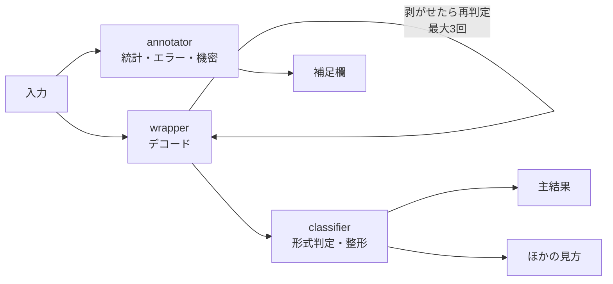
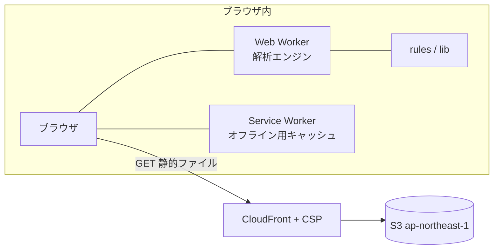

# fmt

**貼るだけで「これ何？」がわかる、ブラウザ完結のデコード＆整形ツール。**

公開: **https://fmt.okamomedia.tokyo/** ・ MIT License

意味がわからない文字列やファイルを貼ると、**何なのか・どこが問題なのか**を日本語で説明します。
解析はすべてブラウザの中だけで行い、**入力した内容をどこにも送信しません**（サーバーがありません）。

- LLM・外部 API・アクセス解析は使っていません
- 初回読み込み後は**オフラインでも動作**します
- 入力は保存しません（再読み込みで消えます）

**動作例（before → after）**: [`docs/report.md`](docs/report.md) — 実際の出力をそのまま並べたレポートです。`npm run report` で再生成できます。

---

## できること

| 入力 | 表示 |
|---|---|
| JWT | ヘッダ・本文・有効期限（日本時間）。期限切れは警告 |
| JSON | 整形＋**構文エラーの位置**（行・文字位置・よくある原因） |
| XML / HTML ソース | タグの入れ子を整形。閉じ忘れを検出 |
| CSV / TSV | 表として表示。**Excel に貼れるタブ区切り**、縦横変換、BOM 付きファイル保存。**列が多い表は自動で縦横変換** |
| ログ（Web / CDN / syslog / メール） | 表に整形（**日時は日本時間**）＋エラー行の抽出＋**HTTP / SMTP コードの意味** |
| メールのソース（.eml） | ヘッダと本文に分離。件名の文字コード復号、**Date は日本時間**、添付一覧（中身は開かない） |
| Cookie | 名前と値に分解（**Expires は日本時間**）。HttpOnly / Secure / SameSite の不足を指摘 |
| URL | ホスト・パス・パラメータに分解。**パラメータは URL デコード（二重エンコードも解除）**。追跡用パラメータを指摘 |
| 証明書 / 鍵（PEM） | 有効期限・発行元・対象ホスト（SAN）・鍵長。**秘密鍵は中身を出さない** |
| 画像（複数可） | 形式・サイズ・EXIF（**日時は現地時間**）・GPS・**QR コード / バーコード** |
| Base64 / data URI | 解除して中身を再判定（画像なら画像として表示・保存） |
| URL エンコード / 16進ダンプ / Unicode エスケープ | 解除して再判定 |
| ハッシュ値 | 長さから種類を**推定**（断定はしない） |
| 日時（英語表記 / GMT） | 日本時間・曜日・現在からの経過に変換 |
| Markdown | HTML に変換して表示（スクリプトと外部画像は無効化）。HTML 保存可 |
| 文字化け | 復元できる型かどうかを判定し、復元できる場合は元の文字に戻す |
| 2段階認証（otpauth） | 秘密キーを検出して警告。マスク ON なら `secret=JB****XP` に |
| 英語のエラー | 意味・よくある原因・次にやることに変換（パターン辞書） |

結果とは別欄に**統計情報**（文字数・行数・バイト数・文字コード・改行・環境依存文字など）と
**補足**（エラーの意味・文字化け・機密情報の検出）を表示します。

### オプション

- **機密情報をマスク**（**既定で ON**） — メール・電話・APIキー・カード番号（Luhn 検証）・マイナンバー（チェックディジット）・住所・IP・
  **AWS アカウントID / ARN・2段階認証のシークレット**を、元が推測できる程度に伏せます
  （例: `t***@g***.com`、`203.0.***.***`、`arn:aws:iam::********9012:role/Admin`）。表示・コピー・保存すべてに適用されます。
  元の値を見たいときはチェックを外してください。
- **エラーの意味を日本語で** — HTTP / SMTP / OS・プログラムのエラーを辞書で説明します。

---

## 安全のためにやっていること

| 項目 | 取扱い |
|---|---|
| 通信 | なし。CloudFront の CSP で `connect-src 'none'`（外部への送信を全面禁止） |
| 解析 | Web Worker 内で完結。画面が固まりにくい |
| 保存 | しない。入力は再読み込みで消える（localStorage 等も使わない） |
| オフライン | Service Worker が全アセットを事前キャッシュ。機内・閉域でも動く |
| HTML | ソースとしてのみ表示。ページとしては描画しない |
| Markdown | `<script>` と外部画像を除去。リンクは `rel="noreferrer"` |
| 証明書・鍵 | 秘密鍵の中身は表示しない（方式とビット数のみ） |
| メール | 添付ファイルの中身は開かない |
| 配信 | S3 は非公開 + CloudFront OAC。S3 への直接アクセス不可 |

`npm run build` は最後に **無通信の静的検査**（`scripts/check-no-network.mjs`）を実行し、
WebSocket / sendBeacon / EventSource / XMLHttpRequest が含まれていたら失敗します。

> Service Worker（`/sw.js`）だけは、初回のオフライン用キャッシュ作成のために**同一オリジンへの fetch** を許可しています
> （`connect-src 'self'`）。ページ本体は `connect-src 'none'` のままなので、入力が外部へ送られる経路はありません。

> 注意: 静的配信基盤には、通常の Web アクセスと同様に IP アドレスや User-Agent などの
> **アクセスログ**が残る場合があります。入力した内容は含まれません。

---

## 使い方

### Web で使う

**https://fmt.okamomedia.tokyo/** を開くだけ。インストール不要です。

1. 文字列を貼り付け（`Ctrl+V`）、または画像をドラッグ＆ドロップ / 「画像を選ぶ」
2. 結果・統計・補足が自動で出ます
3. 必要なら「機密情報をマスク」をオンにしてからコピー・保存

### ローカルで使う

```bash
git clone https://github.com/okamoto53515606/fmt.git
cd fmt
./scripts/dev.sh
```

```bash
npm install
npm run dev      # 開発サーバー（http://localhost:5173/）
npm run build    # 型チェック → dist/ → SW 生成 → 無通信検査
npm test         # ルールのフィクスチャ検証（ビルド不要）
npm run report   # docs/report.md（before → after）を再生成
npm run test:samples  # レポートが最新か ＋ サンプルに秘密が混ざっていないかを検証
npm run preview  # ビルド結果の確認
```

---

## 解析の仕組み（エンジニア向け）

### 3 層モデル



| 層 | 役割 | 例 |
|---|---|---|
| **wrapper** | デコードして解析しなおす | Base64 / data URI、URL エンコード、16進ダンプ、16進文字列、Unicode エスケープ |
| **classifier** | 形式を見分けて整形する | JWT、JSON、XML、HTML、CSV、ログ、メール、Cookie、URL、証明書、画像、エラー、Markdown、文字化け、ハッシュ、日時、コード |
| **annotator** | 出力は変えず補足を足す | エラーの意味（辞書）、機密情報の検出 |

- **複数一致したとき**は、いちばん確からしい1つを**主結果**にし、残りは「ほかの見方」として並べます。
  変換を合成しないので、`Base64 → JSON → さらに Base64` のような無限連鎖は起きません（深さ 3 で停止）。
- スコアが 55 未満のときは**自動変換せず**「推定」と表示し、変換しなかった場合はその旨を明示します。
- 「根拠」（`evidence`）は各判定に必ず持たせています。判定に納得できないときはここを見てください。

### ルールを追加する

`src/rules/` に 1 ファイル作り、`src/rules/index.ts` に 1 行足すだけです。

```ts
export const myRule: ClassifierRule = {
  id: 'my-format',
  layer: 'classifier',
  appliesTo: 'text',
  label: 'マイ形式',
  detect(ctx) {
    if (!ctx.text.startsWith('XYZ:')) return null;
    return { score: 90, confidence: 'high', title: 'マイ形式', summary: '…', evidence: ['XYZ: で始まる'] };
  },
  transform(ctx) {
    return result('my-format', 'マイ形式', '表示しました', [{ type: 'code', text: ctx.text }]);
  },
  fixtures: [{ name: '基本', input: 'XYZ:1', expect: { score: 90 } }],
};
```

- `fixtures` を書くと `npm test` が input → 期待スコアを検証します（**判定ツールの品質はここで守ります**）。
- `scripts/sample-cases.mjs` に 1 件足すと、`docs/report.md` の before → after と検証（`npm run test:samples`）の両方に反映されます。
- サンプル画像に **2段階認証の QR** を入れると `npm run check:samples` が失敗します（公開リポジトリに秘密を入れないため）。
- 返せるブロック: `text` / `code` / `kv` / `table` / `markdown` / `image` / `notice`
- ダウンロードは `dl(ラベル, ファイル名, テキスト, MIME)` で定義（マスキングON時は自動で伏せ字になります）
- 新しい依存を足すときは、**外部へ通信しないこと**を確認してください（ビルド時の検査で検出できます）

---

## 制限（正直に）

- 暗号化されたデータの中身は読めません（種類の推定まで）。復号はしません。
- ハッシュ値は元に戻せません。長さからの推定のみです。
- 英語の**長文**の翻訳はしません。よくあるエラーの意味を辞書で引く方式です。
- JWT の署名検証、証明書の失効確認（CRL/OCSP）は行いません。
- マスキングは取りこぼしがあります。共有前の目視確認をおすすめします。
- HEIC はブラウザで表示できる形式に変換して解析します（元ファイルは変更しません）。
- 入力の上限はテキスト 4MB / 画像 25MB・1枚です（超えた分は先頭のみ解析）。

---

## 構成



| 領域 | 採用技術 |
|---|---|
| ビルド | Vite 8 + TypeScript（strict） |
| 解析 | 独自エンジン（wrapper / classifier / annotator）＋ Web Worker |
| 画像 | `createImageBitmap` / `OffscreenCanvas`、HEIC は `heic2any`（遅延読み込み） |
| QR・バーコード | `@zxing/library`（遅延読み込み） |
| EXIF | `exifr` |
| Markdown | `marked` ＋ 独自サニタイザ（許可要素のみ） |
| 証明書 | 独自 ASN.1/DER パーサ（X.509・PKCS#1・PKCS#8） |
| 配信 | S3（ap-northeast-1）+ CloudFront（OAC）+ ACM（us-east-1） |
| IaC | CloudFormation（`template.yaml`） |

バックエンドはありません。Lambda / API / DB は使いません。

---

## デプロイ

```bash
# 独自ドメインなし（CloudFront の既定ドメイン）
AWS_PROFILE=my-profile ./scripts/deploy.sh

# fmt.okamomedia.tokyo で公開（ACM 証明書は us-east-1 で発行）
AWS_PROFILE=my-profile \
  DOMAIN_NAME=fmt.okamomedia.tokyo \
  ACM_CERT_ARN=arn:aws:acm:us-east-1:... \
  ./scripts/deploy.sh
```

DNS は `fmt.okamomedia.tokyo` を CloudFront の Distribution Domain Name に向けます
（Route 53 なら A レコードのエイリアス）。`index.html` と `sw.js` はキャッシュ無効で配信し、
更新時に `create-invalidation` を実行します。

### SNS 用の画像（OG 画像）

`public/og.png`（1200×630）は `npm run og` で生成します（`scripts/make-og.mjs`、
開発時のみ使う `@napi-rs/canvas` と Noto Sans CJK JP で描画）。文章を変えたら再生成して
デプロイしてください。`index.html` の `og:image` / `twitter:image` がこの画像を指します。

---

## 前提が変わったときの要注意事項

| 前提 | 崩れたときに効く箇所 |
|---|---|
| 入力はサーバーに送らない | 解析 API や LLM を足すと README の「通信しません」が嘘になる。CSP の `connect-src 'none'` も同時に緩める必要があり、その時点でサービス憲章の見直しが必要 |
| ルールはブラウザ内の決定的な処理だけで書ける | 外部辞書の取得やモデル推論を足すと、オフライン動作（SW の事前キャッシュ）と CSP が両方壊れる |
| 配信は静的のみ（Lambda なし） | サーバー処理を足すなら、入力データの保存・ログ・削除方針を別途決める必要がある |
| HEIC 変換に blob Worker を使う | CSP の `worker-src` / `script-src` から `blob:` を外すと HEIC が解析できなくなる |
| 入力上限は 4MB / 25MB | 上限を上げると Worker のメモリと待ち時間が増える。表・ログの表示上限（200〜500 行）も合わせて見直す |
| Service Worker で全アセットを事前キャッシュ | アセットが増えると初回のダウンロードが重くなる。`gen-sw.mjs` の対象を絞るか、オフライン対象を分ける |
| Service Worker は自ホストのアセットだけをキャッシュする | `/sw.js` の CSP を緩めた状態でサードパーティ製 SW を入れると外部送信の抜け道になる。SW は自前のものだけを配信し、外部 URL を書かない |
| マスキングは「誤検知が少ない型のみ」 | 対象を広げるほど誤検知が増え、利用者がマスク結果を信用しなくなる。追加時はフィクスチャで誤検知を固定する |